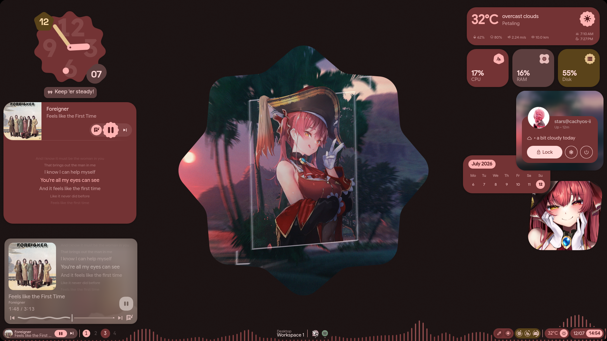
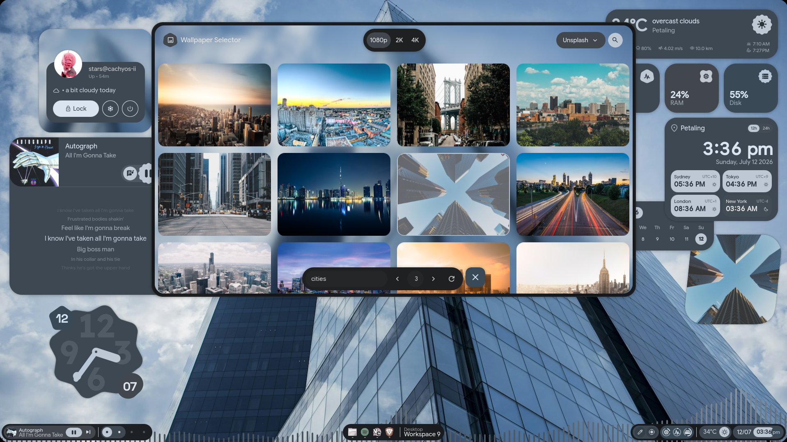
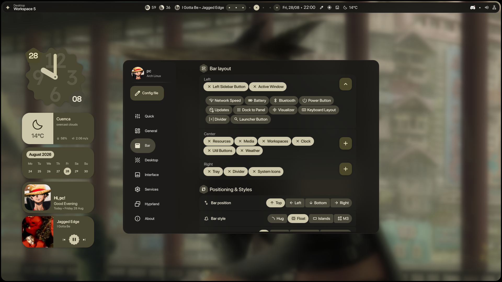
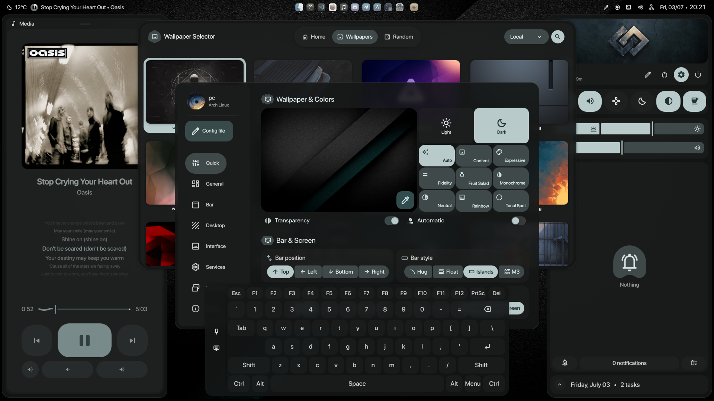
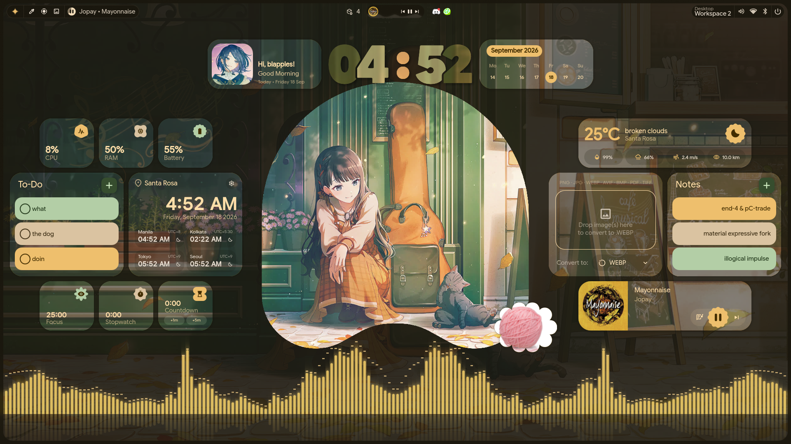
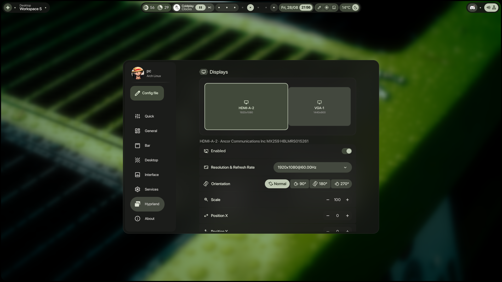

 <div align="center">

# 💠 end4-pC

### Material You. Expressive design. Hyprland.

**A refined Quickshell experience built on [illogical-impulse](https://github.com/end-4/dots-hyprland).**

Maintained by **[pctrade](https://github.com/pctrade)**

[](https://github.com/pctrade/end4-pC/stargazers)
[](https://github.com/pctrade/end4-pC/network/members)
[](https://github.com/pctrade/end4-pC/commits)
[](LICENSE)

[**English**](README.md) · [简体中文](README.zh-CN.md) · [日本語](README.ja.md)

<br/>

*A desktop shell should feel like part of the operating system — not another application sitting on top of it.*

<br/>

[**Explore the project**](#-features) · [**Installation**](#-installation) · [**Community presets**](#-community-presets) · [**FAQ**](#-faq)

</div>

---

## ✦ The experience

<div align="center">

<a href="https://www.youtube.com/watch?v=o0Vsh7eVchs">
  
</a>

<p><sub>▶ Watch the desktop showcase on YouTube</sub></p>

</div>

**end4-pC** is a personal fork of the [illogical-impulse](https://github.com/end-4/dots-hyprland) desktop shell, maintained by **pctrade**. It brings a distinctive visual identity to a Hyprland workflow through a customizable Quickshell interface, expressive styling, desktop widgets, and integrated configuration tools.

The goal is simple: a desktop that looks cohesive, feels responsive, and stays configurable without forcing you to rebuild your workflow around it.

> [!IMPORTANT]
> end4-pC is a fork, not a standalone replacement for the entire Hyprland setup. It requires [illogical-impulse](https://github.com/end-4/dots-hyprland) to be installed and running.

## ✨ Features

<table>
<tr>
<td width="50%" valign="top">

### 🎨 Expressive interface

A cohesive visual language inspired by modern Material design.

- Dynamic accent colors
- Consistent panel and component styling
- Configurable desktop appearance
- Integrated settings interface

</td>
<td width="50%" valign="top">

### 🖥️ Desktop widgets

Useful information and controls, available directly from the desktop.

- Desktop widgets
- Weather integration
- Lyrics display
- Configurable visual elements

</td>
</tr>
<tr>
<td width="50%" valign="top">

### 🪟 Hyprland integration

Designed around a keyboard-driven desktop workflow.

- Launcher and overview
- Workspace-oriented navigation
- Configurable bar and workspace indicators
- Hyprland keybind integration

</td>
<td width="50%" valign="top">

### 🌌 Wallpapers and effects

Customize the atmosphere of your desktop.

- Online wallpaper browsing
- Shader transitions
- Visual effects and styling
- Customizable shell appearance

</td>
</tr>
<tr>
<td width="50%" valign="top">

### ⚙️ Built-in configuration

Change your desktop without manually editing every component.

- Settings overlay
- Searchable settings through the launcher
- Configurable bar and widgets
- Centralized appearance options

</td>
<td width="50%" valign="top">

### 💠 Community presets

Discover and share desktop configurations.

- Browse community presets
- Preview configurations
- Download or install presets
- Share your own setup

</td>
</tr>
</table>

*Features may depend on the installed illogical-impulse version, configured modules, and available integrations.*

---

## 📸 Screenshots

<div align="center">

<table>
<tr>
<td width="50%" align="center">

**01 — Lyrics**



</td>
<td width="50%" align="center">

**02 — Online wallpapers**



</td>
</tr>
<tr>
<td width="50%" align="center">

**03 — Configurable bar**



</td>
<td width="50%" align="center">

**04 — Desktop experience**



</td>
</tr>
<tr>
<td width="50%" align="center">

**05 — Desktop widgets**



</td>
<td width="50%" align="center">

**06 — Hyprland configuration**



</td>
</tr>
</table>

</div>

---

## 🎨 Community presets

### Your desktop. Your style. One click away.

The [**end4-pCpresets**](https://github.com/pctrade/end4-pCpresets) repository is the community gallery for sharing and discovering shell configurations.

Open **Dashboard → Presets** inside the shell to explore available configurations.

<div align="center">

| Action | What it does |
|:---|:---|
| **Download** | Try a preset without committing to it as your permanent setup. |
| **Install** | Keep a preset as part of your desktop configuration. |
| **Upload** | Share your own preset with a screenshot. |
| **Remove from gallery** | Remove a preset you previously shared. |

</div>

### How sharing works

1. Open the Presets page in the Dashboard.
2. Choose **Upload** and select a screenshot.
3. Complete the GitHub authentication flow when prompted.
4. Submit your preset to the community gallery.

The first upload may open a terminal to install the [GitHub CLI](https://cli.github.com) (`gh`) and authenticate your account. If you skip that process, the shell provides a GitHub page-based alternative.

### Privacy and review

- **Privacy-conscious:** the gallery workflow is designed around public repository files.
- **Clean exports:** personal paths, keys, and commands are removed before sharing.
- **Automated checks:** submitted presets go through automated validation.
- **Contributor review:** first-time contributors receive manual review; trusted contributors can use the automated approval workflow.
- **Ownership:** only the contributor who shared a preset can update or remove their submission.

[**Browse presets →**](https://github.com/pctrade/end4-pCpresets) · [**Read the sharing guide →**](https://github.com/pctrade/end4-pCpresets#share-your-preset)

---

## ⚡ Installation

### Prerequisites

Before installing end4-pC, make sure you have:

- [Hyprland](https://github.com/hyprwm/Hyprland) configured and working.
- [illogical-impulse](https://github.com/end-4/dots-hyprland) installed and running.
- [Quickshell](https://quickshell.org/) available through your existing setup.
- Git installed.

> [!NOTE]
> end4-pC uses its own configuration directory at `~/.config/quickshell/end4-pC`. It is intended to keep this fork separate from the existing `ii` configuration rather than overwrite it. Both configurations may still share dependencies and system-level settings.

### 1. Clone the repository

```bash
mkdir -p ~/.config/quickshell
cd ~/.config/quickshell

git clone https://github.com/pctrade/end4-pC.git
```

### 2. Launch end4-pC

```bash
killall qs 2>/dev/null
qs -c end4-pC
```

This starts the `end4-pC` Quickshell configuration. The command above runs it in the foreground, making terminal output available for troubleshooting.

To launch it in the background instead:

```bash
qs -c end4-pC > /tmp/end4-pC.log 2>&1 &
disown
```

If the shell fails to start, inspect the log:

```bash
tail -n 100 /tmp/end4-pC.log
```

> [!TIP]
> If Quickshell is already running, restarting it will interrupt the current shell session. Save any work in progress before restarting.

### 3. Make end4-pC the default shell (optional)

If you want end4-pC to load by default instead of `ii`, open:

```text
~/.config/hypr/hyprland/variables.lua
```

Find:

```lua
hl.env("qsConfig", "ii")
```

Change it to:

```lua
hl.env("qsConfig", "end4-pC")
```

Save the file and reload Hyprland:

```bash
hyprctl reload
```

If the new configuration is not picked up by the running session, restart Hyprland or restart Quickshell using the launch command above.

### 4. Add a settings keybind (optional)

To toggle the settings overlay with `Super + Escape`, add this to your Hyprland configuration:

```lua
hl.bind(
    "SUPER + escape",
    hl.dsp.global("quickshell:settingsToggle"),
    { description = "Toggle settings" }
)
```

> [!NOTE]
> Settings opens as an overlay rather than a regular application window. `Super + Q` will not necessarily close it. Use the same keybind to toggle it, or press `Escape`.

---

## ⌨️ Everyday workflow

### Find settings quickly

You do not need a separate search field inside Settings.

1. Open the launcher with `Super`.
2. Type a keyword such as `wallpaper`, `bar`, or `blur`.
3. Select the relevant result to jump to the matching page or section.

### Inspect configured keybinds

1. Open the launcher with `Super`.
2. Type `<`.
3. Browse the configured keybind list.

> Keybinds can vary depending on your illogical-impulse configuration and any customizations you have made.

---

## ❓ FAQ

<details>
<summary><strong>Does end4-pC replace illogical-impulse?</strong></summary>

No. end4-pC is a personal fork of the illogical-impulse shell and requires the underlying setup to be installed and running.

</details>

<details>
<summary><strong>Will installing end4-pC overwrite my existing shell?</strong></summary>

The repository uses its own Quickshell configuration directory, `~/.config/quickshell/end4-pC`. Installing the repository there does not require replacing the `ii` configuration. Changing the default `qsConfig` value is optional.

</details>

<details>
<summary><strong>How do I switch back to ii?</strong></summary>

Restore the default configuration value in `~/.config/hypr/hyprland/variables.lua`:

```lua
hl.env("qsConfig", "ii")
```

Then reload Hyprland and restart Quickshell if necessary.

</details>

<details>
<summary><strong>Why does the settings panel not have its own search bar?</strong></summary>

Use the launcher search instead. Open the launcher and enter a relevant keyword, such as `wallpaper`, `bar`, or `blur`, to find matching pages and sections.

</details>

<details>
<summary><strong>Quickshell starts, but the interface does not appear. What should I check?</strong></summary>

Start the configuration from a terminal so that errors are visible:

```bash
qs -c end4-pC
```

Check that illogical-impulse and its required dependencies are installed correctly. If you launch it in the background, inspect `/tmp/end4-pC.log` for errors.

</details>

<details>
<summary><strong>Can I customize the configuration?</strong></summary>

Yes. You can customize your local configuration and adapt the shell to your own workflow. Keep a copy of your changes before pulling upstream changes that may modify the same files.

</details>

---

## 🛠️ Contributing

Improvements, bug reports, and thoughtful contributions are welcome.

- **Bug reports:** include reproduction steps and relevant terminal output.
- **Feature ideas:** describe the use case and how the change fits the existing shell.
- **Pull requests:** keep changes focused and explain their impact.
- **Presets:** share your desktop configuration through the [community gallery](https://github.com/pctrade/end4-pCpresets).

Before opening an issue, check whether the problem is caused by end4-pC itself, the underlying illogical-impulse setup, or a missing dependency.

---


<div align="center">

### Make your desktop feel like yours.

**end4-pC** · Maintained by Bryan

[Repository](https://github.com/pctrade/end4-pC) · [Community presets](https://github.com/pctrade/end4-pCpresets) · [Original project](https://github.com/end-4/dots-hyprland)

<sub>Built on open source. Customized for your workflow.</sub>

</div>
